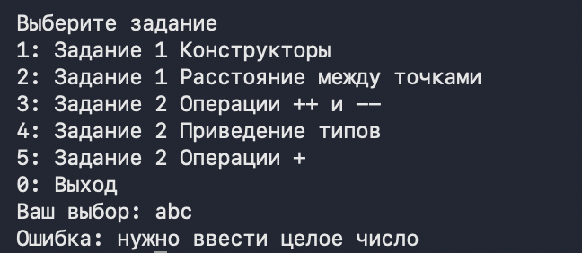
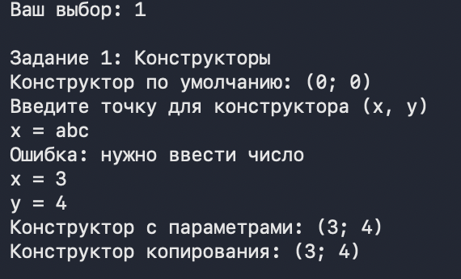
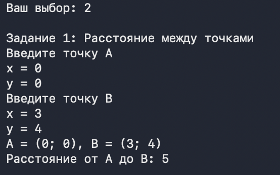
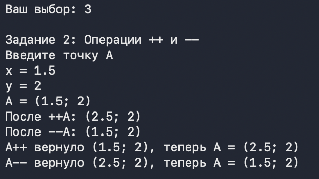
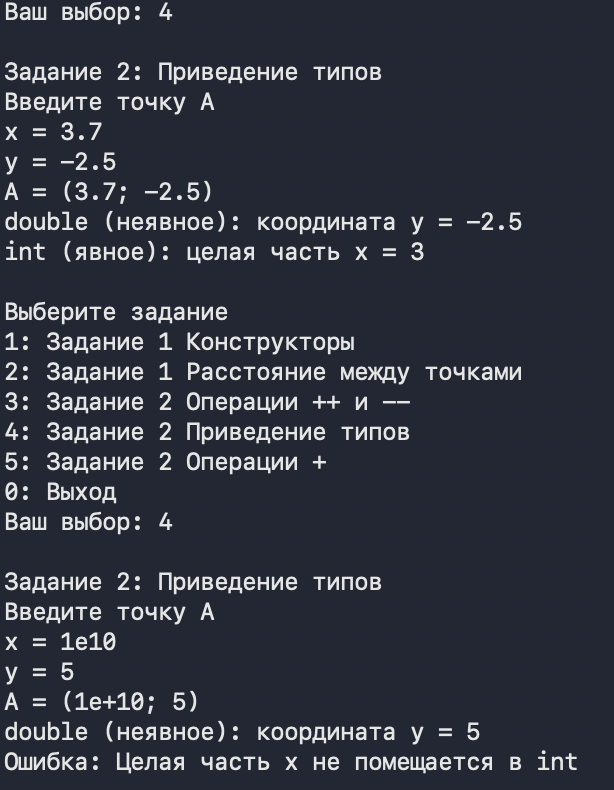
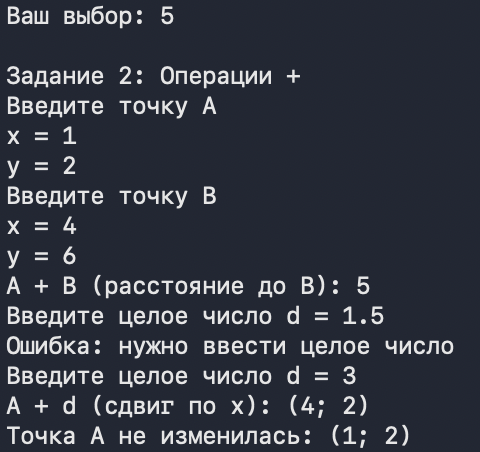

# Лабораторная работа №4. Перегрузка операторов

Программа на C++ (вариант 3): класс `Point` (точка на плоскости) с перегруженными операторами и консольное меню для проверки заданий 1 и 2. Полный отчёт со скриншотами приведён ниже в разделе «Отчёт», скриншоты лежат в папке `Screens/`.

Файлы проекта: `Point.h`, `Point.cpp`, `Input.h`, `Input.cpp`, `main.cpp`.

## Сборка и запуск

```
g++ -std=c++17 Point.cpp Input.cpp main.cpp -o lab4
./lab4
```

## Особенности реализации

- Класс разделён на заголовочный файл (объявление с Doxygen-документацией) и файл реализации. Класс лежит в пространстве имён `lab4`, функции ввода из лабораторной №3 – в пространстве имён `input`.
- Инвариант класса: координаты всегда конечные числа. Конструктор с параметрами и сеттеры `set_x`, `set_y` проверяют значение функцией `CheckFinite` и при нарушении бросают `std::invalid_argument`.
- Расстояние считается через `std::hypot`, что защищает от переполнения при возведении в квадрат больших координат.
- Приведение к `int` объявлено `explicit`, приведение к `double` – неявное, как требует вариант.
- Постфиксные `++` и `--` реализованы через префиксные, чтобы логика изменения хранилась в одном месте.
- Ввод с клавиатуры (пункт меню и координаты) проверяется функциями из `Input.h`: при некорректном вводе запрос повторяется, при закрытом потоке ввода программа завершается.

## Отчёт

**Денисов Кирилл Лабораторная №4**

### Меню программы

При запуске программа выводит меню заданий. Пункт выбирается числом от 0 до 5, ввод проверяется функцией `ReadIntInRange`: при некорректном вводе запрос повторяется. Пункт 0 завершает программу.



*Рисунок 0 – Меню программы*

### Задание 1

#### Вариант 3

##### Текст задачи

Реализовать определение класса `Point` (поля `double x`, `double y` – координаты точки; свойства; не менее трёх конструкторов; перегрузка оператора вывода для вывода полей; метод вычисления расстояния от одной точки до другой, результат типа `double`). Протестировать все методы, включая конструкторы. Все исходные данные вводятся с клавиатуры, данные проверяются на корректность.

##### Алгоритм решения

1. Класс `Point` хранит две координаты: `x_` и `y_` типа `double`. Доступ к ним даёт пара геттер и сеттер (`x()`, `y()`, `set_x`, `set_y`).

2. Конструкторов три: по умолчанию (точка (0; 0)), с параметрами (проверяет обе координаты функцией `CheckFinite` в списке инициализации) и копирования. Конструктор копирования и оператор присваивания объявлены как `= default`: у класса нет ресурсов, поэтому достаточно поведения по умолчанию.

3. Оператор `<<` выводит точку в формате «(x; y)». Методы `ToString` и `Print` используют тот же оператор, поэтому форматы совпадают всегда.

4. Метод `DistanceTo(const Point& other)` константный, не изменяет точки и возвращает евклидово расстояние `std::hypot(x_ - other.x_, y_ - other.y_)` типа `double`.

5. В меню для проверки есть два пункта: пункт 1 тестирует конструкторы и вывод, пункт 2 – вычисление расстояния между введёнными точками A и B.

##### Тестирование



*Рисунок 1 – Задание 1, конструкторы и вывод: работа программы*

*Таблица 1 – Контрольные примеры, конструкторы и вывод*

| **Входные данные** | **Ожидается** |
|---|---|
| `Point()` | `(0; 0)` |
| `Point(3, 4)` | `(3; 4)` |
| `Point(2.5, -1)` | `(2.5; -1)` |
| копия `Point(3, 4)` | `(3; 4)` |
| ввод `abc` вместо координаты | `Ошибка: нужно ввести число`, запрос повторяется |



*Рисунок 2 – Задание 1, расстояние между точками: работа программы*

*Таблица 2 – Контрольные примеры, расстояние*

| **Входные данные** | **Ожидается** |
|---|---|
| A = (0; 0), B = (3; 4) | `5` |
| A = (1; 1), B = (1; 1) | `0` |
| A = (-1; -1), B = (2; 3) | `5` |
| A = (0; 0), B = (1; 0) | `1` |

### Задание 2

#### Вариант 3

##### Текст задачи

Добавить к классу `Point` из задания 1 следующие перегруженные операции.

Унарные операции:

- `++` – увеличить координату x на 1;
- `--` – уменьшить координату x на 1.

Операции приведения типа:

- `int` (явная) – результатом является целая часть координаты x;
- `double` (неявная) – результатом является координата y.

Бинарные операции:

- `+ Point p` – вычисляется расстояние до точки p, результатом должно быть вещественное число;
- `+ целое число` – увеличивается координата x, результатом является объект типа `Point`.

В главной функции `main` показать работу всех функций с дружественным интерфейсом.

#### Операции ++ и --

##### Алгоритм решения

1. Префиксные `operator++()` и `operator--()` изменяют `x_` на 1 и возвращают ссылку на сам объект.

2. Постфиксные `operator++(int)` и `operator--(int)` (фиктивный параметр `int` отличает их от префиксных) сохраняют копию точки до изменения, вызывают префиксную версию и возвращают копию.

3. В меню показано различие: после `++A` и `--A` выводится сама точка, а для `A++` и `A--` выводятся и возвращённое значение (до изменения), и новое значение A.

##### Тестирование



*Рисунок 3 – Задание 2, операции ++ и --: работа программы*

*Таблица 3 – Контрольные примеры, операции ++ и -- (начальное A = (1.5; 2))*

| **Операция** | **Результат выражения** | **A после операции** |
|---|---|---|
| `++A` | `(2.5; 2)` | `(2.5; 2)` |
| `--A` | `(1.5; 2)` | `(1.5; 2)` |
| `A++` | `(1.5; 2)` | `(2.5; 2)` |
| `A--` | `(2.5; 2)` | `(1.5; 2)` |

#### Приведение типов

##### Алгоритм решения

1. `explicit operator int()` возвращает целую часть `x_` (дробная часть отбрасывается). Перед приведением проверяется, что значение помещается в `int`: условие `x_ > INT_MIN - 1.0 && x_ < INT_MAX + 1.0` пропускает все числа, усечение которых даёт корректный `int`. Иначе бросается `std::out_of_range`.

2. `operator double()` неявно возвращает `y_`.

3. Явное приведение `static_cast<int>(a)` в меню обёрнуто в `try`/`catch`, чтобы переполнение не завершало программу аварийно.

##### Тестирование



*Рисунок 4 – Задание 2, приведение типов: работа программы*

*Таблица 4 – Контрольные примеры, приведение типов*

| **Входные данные** | **`double` (y)** | **`int` (целая часть x)** |
|---|---|---|
| A = (3.7; -2.5) | `-2.5` | `3` |
| A = (-3.7; 1) | `1` | `-3` |
| A = (0.9; 0) | `0` | `0` |
| A = (1e10; 5) | `5` | `Ошибка: Целая часть x не помещается в int` |

#### Бинарные операции +

##### Алгоритм решения

1. `double operator+(const Point& other) const` вызывает `DistanceTo`, не дублируя вычисление.

2. `Point operator+(int d) const` создаёт и возвращает новую точку `Point(x_ + d, y_)`. Исходная точка не меняется, поэтому оператор константный.

3. В меню вводятся точки A и B и целое число d (через `ReadInt`), после чего выводятся расстояние, сдвинутая точка и исходная A для подтверждения, что она не изменилась.

##### Тестирование



*Рисунок 5 – Задание 2, операции +: работа программы*

*Таблица 5 – Контрольные примеры, операции +*

| **Входные данные** | **`A + B`** | **`A + d`** | **A после** |
|---|---|---|---|
| A = (1; 2), B = (4; 6), d = 3 | `5` | `(4; 2)` | `(1; 2)` |
| A = (0; 0), B = (0; 0), d = -2 | `0` | `(-2; 0)` | `(0; 0)` |
| A = (2.5; 1), B = (2.5; 1), d = 0 | `0` | `(2.5; 1)` | `(2.5; 1)` |
| ввод `1.5` вместо целого d | `Ошибка: нужно ввести целое число`, запрос повторяется | | |
